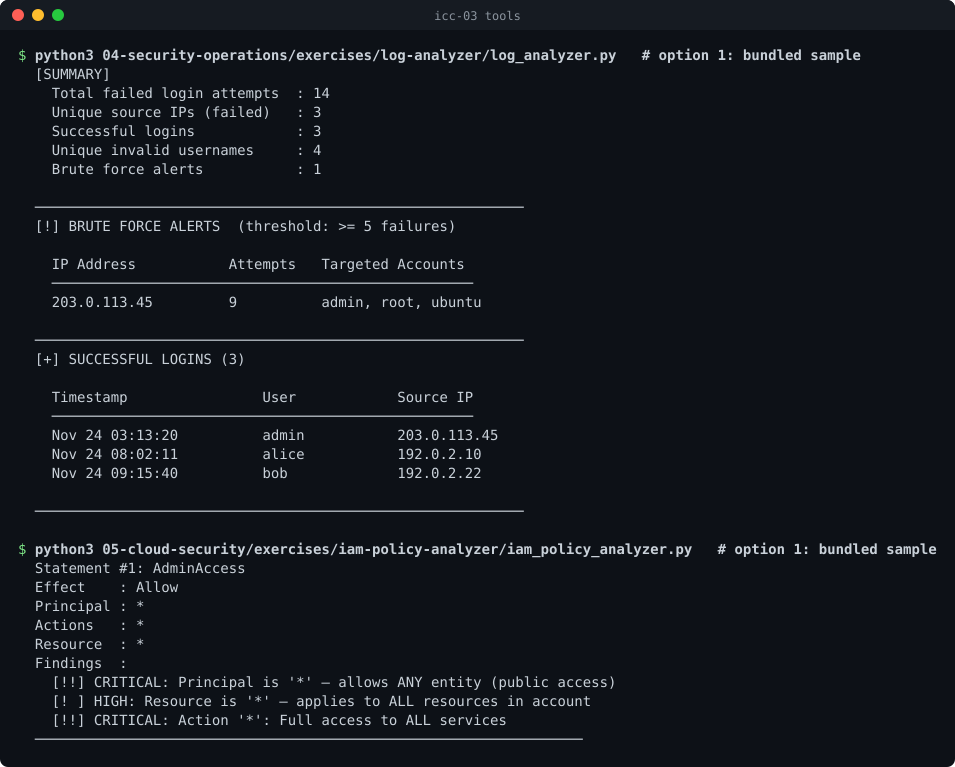

<p align="center">
  
</p>

# ICC-03 Cybersecurity Portfolio

[](https://github.com/CMD126/ICC-03-Personal-Repo/actions/workflows/ci.yml)
[](./LICENSE.md)


13 Python and 4 Bash security tools I wrote from scratch during the ICC-03 cybersecurity program, covering detection (SOC), threat hunting, cloud and web security, cryptography and recon. Each tool has a README next to it. Every push is checked by CI: ruff, 193 offline tests and ShellCheck.

**Status:** maintained. Changes are listed in the [CHANGELOG](./CHANGELOG.md).

**Contents**

- [Principles](#principles)
- [Install and run](#install-and-run)
- [Using it](#using-it)
- [Architecture](#architecture)
- [Development](#development)
- [Limits of this version](#limits-of-this-version)
- [Responsible use](#responsible-use)
- [Reference](#reference): [Tools](#tools), [Modules](#modules), [Framework mapping](#framework-mapping)
- [Contact and contributing](#contact-and-contributing)
- [License](#license)

**Highlights**

- **[log-analyzer](./04-security-operations/exercises/log-analyzer/)**: reads a Linux SSH `auth.log` and reports brute force sources, successful logins and username enumeration, SOC style.
- **[iam-policy-analyzer](./05-cloud-security/exercises/iam-policy-analyzer/)**: reviews AWS IAM policies for public principals, wildcard resources and risky actions such as `iam:PassRole` or `iam:CreateAccessKey`.
- **[ioc-scanner](./06-threat-hunting/exercises/ioc-scanner/)**: hunts for known-bad IPs, domains and MD5/SHA-1/SHA-256 file hashes across logs and folders.
- **[ransomware-simulator](./03-data-security/exercises/ransomware-simulator/)**: emulates ransomware (file encryption, ransom wallpaper, full-screen lock window) to study detection, with a sandbox guard whose safety rules are covered by tests.

I built this repository while going through the ICC-03 program. It started as a place to keep my notes, and over time it turned into a set of working tools I wrote myself to understand how things actually work: how a port scanner talks to a socket, how you spot a brute force attack in `auth.log`, why an IAM policy with `"Resource": "*"` should make you nervous.

## Principles

- Standard library first. Most Python tools import nothing outside it. Only the file-encryptor and the ransomware-simulator need extra packages (`cryptography`, plus `Pillow` for the simulator), and each has its own `requirements.txt`.
- Tests run offline. The port scanner is tested against throwaway listeners on `127.0.0.1`, and the Bash tools' input validation is tested with injection payloads.
- Safe by default. The ransomware simulator only works inside a dedicated sandbox folder and refuses unsafe ones (a drive root, your home folder or its parents, or the script's own folder). Set `RANSIM_SANDBOX` to choose another folder.
- Educational scope. The tools exist to learn how things work and to use in a lab.

## Install and run

You need Python 3.10 or newer for the Python tools and Bash for the shell tools.

```bash
git clone https://github.com/CMD126/ICC-03-Personal-Repo.git
cd ICC-03-Personal-Repo

# Most Python tools only need the standard library
python3 04-security-operations/exercises/log-analyzer/log_analyzer.py

# Bash tools
bash tools/recon-tool/recon_tool.sh
```

A few tools need extra packages (`cryptography`, `Pillow`). Those folders have their own `requirements.txt`, so install them only when you need them:

```bash
pip install -r 03-data-security/exercises/file-encryptor/requirements.txt
```

## Using it

1. Pick a tool from the [Tools](#tools) or [Modules](#modules) tables.
2. Read the README in its folder for options and examples.
3. Run the script: `python3 <folder>/<script>.py` for Python, `bash <folder>/<script>.sh` for Bash.
4. Use it only on systems you own or have written permission to test (see [Responsible use](#responsible-use)).



Real output of two of the tools on the sample data that ships with them. Regenerate it with `docs/render_svg.py`.

### What I can do (and where to see it)

Instead of listing buzzwords, here is each skill next to the code that shows it.

| Area | What I did | Proof |
|------|------------|-------|
| Network reconnaissance | Wrote a multithreaded TCP connect scanner using Python stream sockets, then a menu-driven Nmap front end and an OSINT recon script (WHOIS, DNS, subdomains, TLS) | [port-scanner](./08-penetration-testing/exercises/port-scanner/), [nmatrix](./tools/nmatrix/), [recon-tool](./tools/recon-tool/) |
| Log analysis and detection | Parsed SSH `auth.log` to flag brute force sources, successful logins and username enumeration, with a SOC style report | [log-analyzer](./04-security-operations/exercises/log-analyzer/) |
| Threat hunting | Built an IOC scanner that matches IPs, domains and file hashes in logs and folders against a threat intel feed | [ioc-scanner](./06-threat-hunting/exercises/ioc-scanner/) |
| Cloud security | Wrote an analyzer for AWS IAM policies that flags public principals, wildcard resources and privilege escalation actions like `iam:PassRole` | [iam-policy-analyzer](./05-cloud-security/exercises/iam-policy-analyzer/) |
| Web application security | Audited HTTP security headers (CSP, HSTS, X-Frame-Options and others), caught version leaks, graded sites A to F | [web-headers-checker](./07-appsec/exercises/web-headers-checker/) |
| Cryptography | Used PBKDF2 key derivation with Fernet for file encryption, identified and compared hashes in constant time, showed why fast hashes are bad for passwords | [file-encryptor](./03-data-security/exercises/file-encryptor/), [hash-toolkit](./tools/hash-toolkit/), [password-auditor](./03-data-security/exercises/password-auditor/) |
| Adversary emulation | Simulated ransomware behaviour (encryption, ransom note, wallpaper change) in an isolated VM to understand what defenders need to detect | [ransomware-simulator](./03-data-security/exercises/ransomware-simulator/) |
| Linux hardening | Audited file permissions, found world-writable files and SUID/SGID binaries | [file-permissions-auditor](./00-foundations/exercises/file-permissions-auditor/) |
| Risk management | Built a risk register using Likelihood × Impact scoring with response strategies, stored as JSON | [risk-assessment-tool](./02-grc/exercises/risk-assessment-tool/) |
| Networking and sysadmin | Subnetting, Bash admin toolkits, network diagnostics and a DNS benchmark that measures real UDP queries | [subnet-calculator](./01-networking-and-sysadmin/exercises/subnet-calculator/), [syscript](./tools/syscript/), [network-tool](./tools/network-tool/), [abdns](./tools/abdns/) |

## Architecture

- `00-foundations/` to `08-penetration-testing/`: one folder per course module. Each has a `notes/` folder with cheat sheets and an `exercises/` folder with a hands-on tool.
- `tools/`: six larger utilities (`abdns`, `hash-toolkit`, `network-tool`, `nmatrix`, `recon-tool`, `syscript`), each in its own folder with a README.
- `tests/`: one pytest file per tested area (`test_log_analyzer.py`, `test_port_scanner.py`, `test_bash_input_validation.py` and so on). The tool folders have hyphens in their names, so `tests/conftest.py` loads each script by path instead of importing it.
- `docs/`: `banner.svg`, `demo.svg` and `render_svg.py`, which regenerates the demo image.
- `pyproject.toml`: ruff settings (line length 120, target Python 3.10) and pytest settings (`testpaths = ["tests"]`).
- `.github/workflows/ci.yml`: three jobs on every push to `main` and every pull request: Python lint and tests, ShellCheck, and a Markdown link check.

## Development

To run the same checks as CI locally:

```bash
pip install ruff pytest -r 03-data-security/exercises/ransomware-simulator/requirements.txt
ruff check .
pytest -q
```

CI also runs `shellcheck -S error` on every `*.sh` file and checks Markdown links offline with lychee. The suite has 193 tests when `cryptography` and `Pillow` are installed. Without them, the file-encryptor and ransomware-simulator test files are skipped and fewer tests run. The Bash input-validation tests are skipped when `bash` is not installed.

## Limits of this version

- These are educational tools, not production software.
- Tests cover the logic listed above (log parsing, IOC matching, IAM findings, risk scoring, header grading, hash identification, subnetting, password cracking, file permission checks, file encryption, the port scanner, Bash input validation, the ransomware simulator, and the pure logic of `abdns` and `message_encryptor.py`). Real DNS queries and applying DNS settings in `abdns` are not tested. On Windows the Bash input validation tests and one symlink test are skipped.
- The Bash tools are written for Linux. Some of them also call external programs such as Nmap.
- The ransomware simulator should only ever run inside an isolated, snapshotted VM.

## Responsible use

These tools are for learning and for systems you own or have written permission to test. Scanning or attacking anything else is illegal in most countries. More detail is in [SECURITY.md](./SECURITY.md).

## Reference

### Tools

Bigger utilities I keep improving and actually use. Each one has its own README with options and examples.

| Tool | Language | What it does |
|------|----------|--------------|
| [recon-tool](./tools/recon-tool/) | Bash | OSINT and recon in one menu: WHOIS, DNS records, subdomain brute forcing, port scan, HTTP security headers, SSL/TLS and IP geolocation, with a saved report. |
| [nmatrix](./tools/nmatrix/) | Bash | Nmap front end with 8 scan profiles (quick and full TCP, service and scripts, OS detection, UDP, ping sweep, vuln scripts, custom), scan logging and export. |
| [network-tool](./tools/network-tool/) | Bash | Network diagnostics with 16 options: host discovery, listening services, HTTP checks, firewall status, TLS and DNS (including DNSSEC). |
| [hash-toolkit](./tools/hash-toolkit/) | Python | Identifies hash formats from MD5 to bcrypt and Argon2, generates salted hashes, checks file integrity and compares digests in constant time. |
| [abdns](./tools/abdns/) | Python | Benchmarks 9 public DNS resolvers with real UDP queries, reports packet loss and applies the fastest pair on Linux, macOS or Windows. |
| [syscript](./tools/syscript/) | Bash | Admin toolkit for Ubuntu and Debian: packages, services, firewall, networking and a live health dashboard. |

### Modules

The modules follow the order of the course.

| # | Module | Notes | Exercise |
|---|--------|-------|----------|
| 00 | [Foundations](./00-foundations/) | [Linux](./00-foundations/notes/linux/README.md), [Ubuntu](./00-foundations/notes/ubuntu/README.md) | [file-permissions-auditor](./00-foundations/exercises/file-permissions-auditor/) |
| 01 | [Networking and Sysadmin](./01-networking-and-sysadmin/) | [OSI model](./01-networking-and-sysadmin/notes/osi-model/README.md), [Wireshark](./01-networking-and-sysadmin/notes/wireshark/README.md) | [subnet-calculator](./01-networking-and-sysadmin/exercises/subnet-calculator/) |
| 02 | [Governance, Risk and Compliance](./02-grc/) | [GRC](./02-grc/notes/README.md) | [risk-assessment-tool](./02-grc/exercises/risk-assessment-tool/) |
| 03 | [Data Security](./03-data-security/) | [Data security](./03-data-security/notes/README.md) | [file-encryptor](./03-data-security/exercises/file-encryptor/), [password-auditor](./03-data-security/exercises/password-auditor/), [ransomware-simulator](./03-data-security/exercises/ransomware-simulator/) |
| 04 | [Security Operations](./04-security-operations/) | [SecOps](./04-security-operations/notes/README.md) | [log-analyzer](./04-security-operations/exercises/log-analyzer/) |
| 05 | [Cloud Security](./05-cloud-security/) | [Cloud security](./05-cloud-security/notes/README.md) | [iam-policy-analyzer](./05-cloud-security/exercises/iam-policy-analyzer/) |
| 06 | [Threat Hunting](./06-threat-hunting/) | [Threat hunting](./06-threat-hunting/notes/README.md) | [ioc-scanner](./06-threat-hunting/exercises/ioc-scanner/) |
| 07 | [Application Security](./07-appsec/) | [AppSec](./07-appsec/notes/README.md) | [web-headers-checker](./07-appsec/exercises/web-headers-checker/) |
| 08 | [Penetration Testing](./08-penetration-testing/) | [Nmap](./08-penetration-testing/notes/nmap/README.md) | [port-scanner](./08-penetration-testing/exercises/port-scanner/) |

### Framework mapping

If you think in terms of MITRE ATT&CK or the NIST Cybersecurity Framework 2.0, this is where each project fits. Offensive tools map to the technique they perform. Defensive tools map to the technique they help detect and the CSF function they support.

| Project | MITRE ATT&CK | NIST CSF 2.0 |
|---------|--------------|--------------|
| port-scanner, nmatrix | [T1046](https://attack.mitre.org/techniques/T1046/) Network Service Discovery | ID.AM (asset inventory) |
| recon-tool | [T1595](https://attack.mitre.org/techniques/T1595/) Active Scanning, [T1590](https://attack.mitre.org/techniques/T1590/) Gather Victim Network Information | ID.RA (risk assessment) |
| log-analyzer | Detects [T1110](https://attack.mitre.org/techniques/T1110/) Brute Force | DE.CM, DE.AE (monitoring, adverse event analysis) |
| ioc-scanner | Detects indicators tied to known campaigns | DE.CM, DE.AE |
| iam-policy-analyzer | Finds paths to [T1078.004](https://attack.mitre.org/techniques/T1078/004/) Cloud Accounts and [T1098](https://attack.mitre.org/techniques/T1098/) Account Manipulation | PR.AA (identity and access control) |
| web-headers-checker | OWASP Top 10 A05 Security Misconfiguration | ID.RA, PR.PS |
| password-auditor, hash-toolkit | [T1110.002](https://attack.mitre.org/techniques/T1110/002/) Password Cracking | PR.DS (data security) |
| ransomware-simulator | [T1486](https://attack.mitre.org/techniques/T1486/) Data Encrypted for Impact, [T1491.001](https://attack.mitre.org/techniques/T1491/001/) Internal Defacement | RS, RC (respond, recover) |
| file-encryptor | | PR.DS |
| file-permissions-auditor | Finds candidates for [T1548.001](https://attack.mitre.org/techniques/T1548/001/) Setuid and Setgid | PR.PS (platform security) |
| risk-assessment-tool | | GV.RM, ID.RA (risk management) |

## Contact and contributing

Found a bug or have an idea? Open an issue, or read [CONTRIBUTING.md](./CONTRIBUTING.md) if you want to send a pull request. For anything security related please reach me privately on [LinkedIn](https://www.linkedin.com/in/cmdmiguelsousa/).

## License

Released under the [MIT License](./LICENSE.md).
